# 🏥 PrimeHPM Web — পূর্ণাঙ্গ হাসপাতাল ব্যবহারকারী নির্দেশিকা (User Manual)

স্বাগতম **PrimeHPM Web (Hospital & Pharmacy Management System)**-এ। এটি একটি এন্টারপ্রাইজ-গ্রেড, আধুনিক এবং স্বয়ংক্রিয় হাসপাতাল ও ফার্মেসি ম্যানেজমেন্ট সিস্টেম। এটি **ASP.NET Core 8 Blazor Interactive Server**, **Entity Framework Core 8** এবং **Microsoft SQL Server** প্রযুক্তিতে নির্মিত।

---

## 📑 সূচিপত্র (Table of Contents)

1. [সিস্টেম পরিচিতি ও মূল বৈশিষ্ট্য](#১-সিস্টেম-পরিচিতি-ও-মূল-বৈশিষ্ট্য)
2. [সিস্টেম রিকোয়ারমেন্ট ও চালনা করার নিয়ম](#২-সিস্টেম-রিকোয়ারমেন্ট-ও-চালনা-করার-নিয়ম)
3. [সুপারএডমিন লগইন ও একাউন্ট সিকিউরিটি](#৩-সুপারএডমিন-লগইন-ও-একাউন্ট-সিকিউরিটি)
4. [ব্যবহারকারী রোল ও পারমিশন ম্যাট্রিক্স (RBAC)](#৪-ব্যবহারকারী-রোল-ও-পারমিশন-ম্যাট্রিক্স-rbac)
5. [দৈনন্দিন কাজের পূর্ণাঙ্গ ফ্লোচার্ট (Hospital Operational Workflow)](#৫-দৈনন্দিন-কাজের-পূর্ণাঙ্গ-ফ্লোচার্ট)
6. [মডিউলভিত্তিক সচিত্র বিস্তারিত নির্দেশিকা](#৬-মডিউলভিত্তিক-সচিত্র-বিস্তারিত-নির্দেশিকা)
   - [৬.১ ওভারভিউ ও রিয়েল-টাইম ড্যাশবোর্ড](#৬১-ওভারভিউ-ও-রিয়েল-টাইম-ড্যাশবোর্ড)
   - [৬.২ পেশেন্ট রেজিস্ট্রেশন (Patient Registration - PR)](#৬২-পেশেন্ট-রেজিস্ট্রেশন-patient-registration---pr)
   - [৬.৩ ডক্টর অ্যাপয়েন্টমেন্ট ও সিরিয়াল বুকিং (Doctor Appointments - AP)](#৬৩-ডক্টর-অ্যাপয়েন্টমেন্ট-ও-সিরিয়াল-বুকিং-doctor-appointments---ap)
   - [৬.৪ ওপিডি কনসালটেশন টিকিট ও ফি কালেকশন (Consultation Tickets - TK)](#৬৪-ওপিডি-কনসালটেশন-টিকিট-ও-ফি-কালেকশন-consultation-tickets---tk)
   - [৬.৫ ডক্টর কনসালটেশন কিউ ও ক্লিনিক্যাল ইএমআর (Doctor Queue)](#৬৫-ডক্টর-কনসালটেশন-কিউ-ও-ক্লিনিক্যাল-ইএমআর-doctor-queue)
   - [৬.৬ জরুরি বিভাগ ও ইনস্ট্যান্ট প্রসিডিউর বিলিং (Emergency Services - EM)](#৬৬-জরুরি-বিভাগ-ও-ইনস্ট্যান্ট-প্রসিডিউর-বিলিং-emergency-services---em)
   - [৬.৭ অপারেশন থিয়েটার ও ওটি ক্যাশ মেমো (OT Cash Memo - OT)](#৬৭-অপারেশন-থিয়েটার-ও-ওটি-ক্যাশ-মেমো-ot-cash-memo---ot)
   - [৬.৮ লাইভ বেড অকুপেন্সি বোর্ড (Bed Occupancy Board - BO)](#৬৮-লাইভ-বেড-অকুপেন্সি-বোর্ড-bed-occupancy-board---bo)
   - [৬.৯ ইনপেশেন্ট রোগী ভর্তি ও বেড বরাদ্দ (IPD Admissions - AD)](#৬৯-ইনপেশেন্ট-রোগী-ভর্তি-ও-বেড-বরাদ্দ-ipd-admissions---ad)
   - [৬.১০ আইপিডি অগ্রিম জমা ও মানি রিসিট (Advance Receipts - AR)](#৬১০-আইপিডি-অগ্রিম-জমা-ও-মানি-রিসিট-advance-receipts---ar)
   - [৬.১১ আইপিডি দৈনিক সার্ভিস ও নার্সিং চার্জ (Daily Patient Services - DS)](#৬১১-আইপিডি-দৈনিক-সার্ভিস-ও-নার্সিং-চার্জ-daily-patient-services---ds)
   - [৬.১২ মেডিকেল ডিসচার্জ ক্লিয়ারেন্স অর্ডার (Medical Discharge Orders)](#৬১২-মেডিকেল-ডিসচার্জ-ক্লিয়ারেন্স-অর্ডার-medical-discharge-orders)
   - [৬.১৩ বেড টার্নওভার ও হাউসকিপিং স্যানিটাইজেশন (Bed Turnover)](#৬১৩-বেড-টার্নওভার-ও-হাউসকিপিং-স্যানিটাইজেশন-bed-turnover)
   - [৬.১৪ আইপিডি ফাইনাল ডিসচার্জ ও বিল সেটেলমেন্ট (IPD Final Discharge - DC)](#৬১৪-আইপিডি-ফাইনাল-ডিসচার্জ-ও-বিল-সেটেলমেন্ট-ipd-final-discharge---dc)
   - [৬.১৫ ডায়াগনস্টিক টেস্ট বুকিং ও বিলিং (Diagnostic Billing - DX)](#৬১৫-ডায়াগনস্টিক-টেস্ট-বুকিং-ও-বিলিং-diagnostic-billing---dx)
   - [৬.১৬ ল্যাব স্যাম্পল কালেকশন ওয়ার্কলিস্ট (Diagnostic Worklist - LW)](#৬১৬-ল্যাব-স্যাম্পল-কালেকশন-ওয়ার্কলিস্ট-diagnostic-worklist---lw)
   - [৬.১৭ ল্যাব রেজাল্ট এন্ট্রি ও নরমাল রেঞ্জ ভেরিফিকেশন (Lab Results - LR)](#৬১৭-ল্যাব-রেজাল্ট-এন্ট্রি-ও-নরমাল-রেঞ্জ-ভেরিফিকেশন-lab-results---lr)
   - [৬.১৮ ফার্মেসি কাউন্টার পিওএস সেলস (Pharmacy POS - POS)](#৬১৮-ফার্মেসি-কাউন্টার-পিওএস-সেলস-pharmacy-pos---pos)
   - [৬.১৯ স্টক ইনওয়ার্ড ও পারচেজ চালান (Stock Inward - PI)](#৬১৯-স্টক-ইনওয়ার্ড-ও-পারচেজ-চালান-stock-inward---pi)
   - [৬.২০ লাইভ মেডিসিন স্টক ও এক্সপায়ারি মনিটরিং (Pharmacy Stock - ST)](#৬২০-লাইভ-মেডিসিন-স্টক-ও-এক্সপায়ারি-মনিটরিং-pharmacy-stock---st)
   - [৬.২১ স্টক ভ্যারিয়েন্স ও ফিজিক্যাল অডিট (Stock Control - SC)](#৬২১-স্টক-ভ্যারিয়েন্স-ও-ফিজিক্যাল-অডিট-stock-control---sc)
   - [৬.২২ ফিন্যান্স, অ্যাকাউন্টস ও শিফট ক্লোজিং (Accounts & General Ledger)](#৬২২-ফিন্যান্স-অ্যাকাউন্টস-ও-শিফট-ক্লোজিং-accounts--general-ledger)
   - [৬.২৩ অ্যাডভান্সড রিপোর্ট ও অ্যানালিটিক্স (Hospital Reports & Analytics)](#৬২৩-অ্যাডভান্সড-রিপোর্ট-ও-অ্যানালিটিক্স-hospital-reports--analytics)
   - [৬.২৪ মাস্টার কনফিগারেশন (Clinical, Bed, Lab & Drug Masters)](#৬২৪-মাস্টার-কনফিগারেশন-clinical-bed-lab--drug-masters)
   - [৬.২৫ ইউজার অ্যাডমিন ও রোল পারমিশন (User Admin & Roles)](#৬২৫-ইউজার-অ্যাডমিন-ও-রোল-পারমিশন-user-admin--roles)
   - [৬.২৬ রিয়েল-টাইম সিস্টেম অডিট লগ (Audit Trail & Forensic Logs)](#৬২৬-রিয়েল-টাইম-সিস্টেম-অডিট-লগ-audit-trail--forensic-logs)
   - [৬.২৭ হসপিটাল প্রোফাইল ও প্রিন্ট হেডার সেটিংস (Hospital Profile)](#৬২৭-হসপিটাল-প্রোফাইল-ও-প্রিন্ট-হেডার-সেটিংস-hospital-profile)
7. [সমস্যা ও সমাধান (Troubleshooting & FAQs)](#৭-সমস্যা-ও-সমাধান-troubleshooting--faqs)

---

## ১. সিস্টেম পরিচিতি ও মূল বৈশিষ্ট্য

PrimeHPM হসপিটালের সম্পূর্ণ প্রশাসনিক, ক্লিনিক্যাল এবং আর্থিক কর্মপ্রক্রিয়াকে একক প্ল্যাটফর্মে ডিজিটালাইজ করে:

* **সিঙ্গেল-উইন্ডো অপারেশন:** একই সফটওয়্যার থেকে পেশেন্ট রেজিস্ট্রেশন, ওপিডি কনসালটেশন, জরুরি চিকিৎসা, ওটি, কেবিন/ওয়ার্ড ম্যানেজমেন্ট, ল্যাবরেটরি, ফার্মেসি এবং জেনারেল লেজার পরিচালনা।
* **রিয়েল-টাইম বেড ম্যানেজমেন্ট:** লাইভ বেড অকুপেন্সি বোর্ড (কালার-কোডেড অকুপাইড, ভ্যাকেন্ট ও স্যানিটাইজেশন স্ট্যাটাস)।
* **ফার্মেসি এফআইএফও (FIFO) ও এক্সপায়ারি প্রোটেকশন:** ব্যাচভিত্তিক স্টক ট্র্যাকিং, মেয়াদোত্তীর্ণ ওষুধ বিক্রয় রোধ এবং স্বয়ংক্রিয় পারচেজ রেট প্রটেকশন।
* **ডায়াগনস্টিক ল্যাব অটোমেশন:** বারকোড ট্র্যাকিং, স্যাম্পল কালেকশন ওয়ার্কলিস্ট, প্যারামিটার ভিত্তিক নরমাল রেঞ্জ কম্প্যারিজন ও ভেরিফায়েড রিপোর্ট প্রিন্ট।
* **অটোমেটেড আইপিডি ডিসচার্জ বিলিং:** অবস্থানকাল (Bed Days), ডক্টরস রাউন্ড, নার্সিং চার্জ এবং এডভান্স রিসিটের স্বয়ংক্রিয় নেট সমন্বয়।
* **নিরাপত্তা ও অডিট ট্রেইল:** ইন্ডাস্ট্রি স্ট্যান্ডার্ড ASP.NET Identity অথেন্টিকেশন, ১০টি ডেডিকেটেড রোল-বেসড এক্সেস কন্ট্রোল এবং প্রতি সেকেন্ডের পুঙ্খানুপুঙ্খ ফরেনসিক অডিট লগ।

---

## ২. সিস্টেম রিকোয়ারমেন্ট ও চালনা করার নিয়ম

### প্রয়োজনীয় সফটওয়্যার (Prerequisites):
1. **.NET 8.0 SDK** (বা তার পরবর্তী ভার্সন)
2. **Microsoft SQL Server** (2016 / 2019 / 2022 বা SQL Server Express)
3. **আধুনিক ওয়েব ব্রাউজার** (Google Chrome, Microsoft Edge, বা Mozilla Firefox)

### যেভাবে প্রজেক্ট চালাবেন (How to Run):

#### উপায় ১: কমান্ড লাইনে রান করা (Recommended)
```powershell
dotnet run --project HPM.Web\HPM.Web.csproj --launch-profile http
```
অ্যাপ্লিকেশনটি স্বয়ংক্রিয়ভাবে ডাটাবেজ মাইগ্রেশন সম্পন্ন করবে এবং `http://localhost:5180` পোর্টে চালু হবে।

#### উপায় ২: এক ক্লিকে ব্যাচ ফাইলে রান করা
প্রজেক্ট ফোল্ডারে থাকা **`RUN_HPM_WEB.cmd`** ফাইলটিতে ডাবল ক্লিক করুন।

---

## ৩. সুপারএডমিন লগইন ও একাউন্ট সিকিউরিটি

অ্যাপ্লিকেশন চালু হওয়ার পর ব্রাউজারে প্রবেশ করুন:  
👉 **URL:** `http://localhost:5180/login`

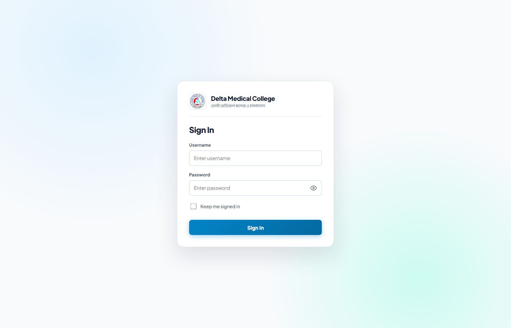

### ডিফল্ট সুপারএডমিন ক্রেডেনশিয়াল (Default Credentials):
* **Username:** `admin`
* **Password:** `Admin@PrimeHpm2026!`

> [!IMPORTANT]
> **প্রথমবার লগইনের ক্ষেত্রে:**
> সিকিউরিটি স্ট্যান্ডার্ড অনুযায়ী প্রথমবার লগইন করার সাথে সাথে সিস্টেম আপনাকে পাসওয়ার্ড পরিবর্তন পেজে রিডাইরেক্ট করবে। সেখানে আপনার সুবিধাজনক ও নিরাপদ স্থায়ী পাসওয়ার্ড সেট করে নিন।

---

## ৪. ব্যবহারকারী রোল ও পারমিশন ম্যাট্রিক্স (RBAC)

PrimeHPM সিস্টেমে মোট **১০টি সুনির্দিষ্ট রোল** রয়েছে:

| রোল (Role) | অনুমোদিত মডিউল ও কাজের পরিধি |
| :--- | :--- |
| **Administrator** | সম্পূর্ণ সিস্টেমের পূর্ণ নিয়ন্ত্রণ, ইউজার তৈরি, রোল অ্যাসাইন, মাস্টার ডাটা সেটআপ, অডিট লগ ও রিপোর্টস। |
| **Reception** | পেশেন্ট রেজিস্ট্রেশন (PR), ডক্টর অ্যাপয়েন্টমেন্ট শিডিউলিং, ওপিডি টিকিট ইস্যু, আইপিডি রোগী ভর্তি। |
| **Cashier** | ওপিডি টিকিট ফি, আইপিডি এডভান্স কালেকশন, ইমার্জেন্সি ও ওটি বিলিং, ডায়াগনস্টিক পেমেন্ট ও শিফট ক্যাশ ক্লোজিং। |
| **Emergency Operator** | জরুরি বিভাগের রোগী এন্ট্রি, ইমার্জেন্সি সার্ভিস মেমো তৈরি ও প্রসিডিউর চার্জিং। |
| **OT Operator** | অপারেশন থিয়েটার শিডিউলিং, সার্জন/অ্যানেস্থেসিয়া চার্জ এন্ট্রি ও ওটি ক্যাশ মেমো জেনারেশন। |
| **IPD Operator** | ইনপেশেন্ট ভর্তি, বেড অ্যালটমেন্ট, বেড ট্রান্সফার, ডেইলি সার্ভিস ও ডিসচার্জ বিলিং প্রসেসিং। |
| **Nurse** | আইপিডি রোগীর দৈনিক নার্সিং সার্ভিস, ভাইটালস এন্ট্রি ও মেডিসিন অ্যাডমিনিস্ট্রেশন চার্ট। |
| **Doctor** | প্রেসক্রিপশন রাইটিং, ওপিডি কনসালটেশন, আইপিডি রাউন্ড নোটস, মেডিকেল ডিসচার্জ ও ল্যাব রেজাল্ট ভিউ। |
| **Lab Technician** | ল্যাব স্যাম্পল কালেকশন, ওয়ার্কলিস্ট প্রসেসিং, টেস্ট রেজাল্ট এন্ট্রি ও রিপোর্ট জেনারেশন। |
| **Pharmacy Operator** | পিওএস কাউন্টার সেলস, ওষুধ ডিসপেনসিং, স্টক ইনওয়ার্ড (পারচেজ), রিটার্ন ও স্টক অডিট। |

---

## ৫. দৈনন্দিন কাজের পূর্ণাঙ্গ ফ্লোচার্ট

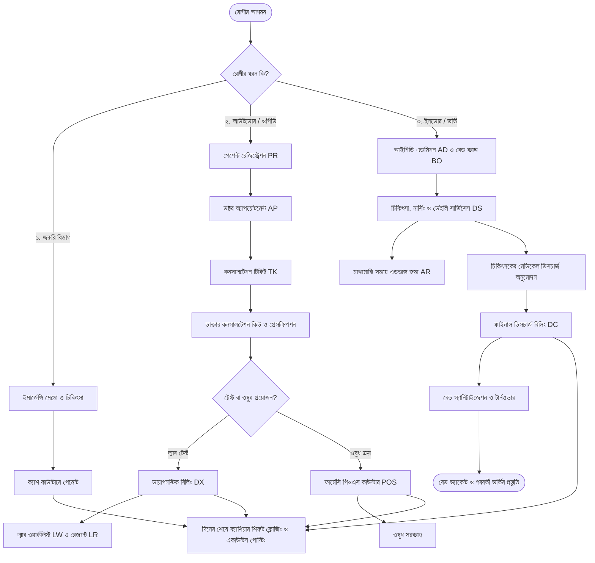

---

## ৬. মডিউলভিত্তিক সচিত্র বিস্তারিত নির্দেশিকা

---

### ৬.১ ওভারভিউ ও রিয়েল-টাইম ড্যাশবোর্ড
* **পাথ:** `/` (Home)
* **অনুমোদিত ইউজার:** Management, Administrator, Superadmin

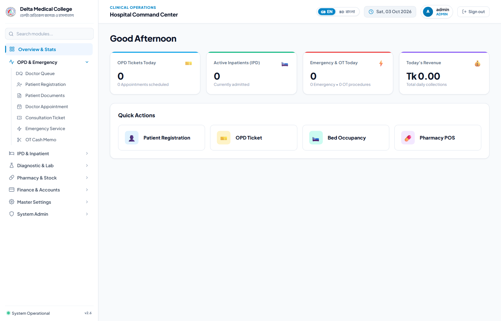

#### মূল ফিচার ও সুবিধা:
1. **লাইভ হসপিটাল কেপিআই:** বর্তমানে ভর্তি থাকা মোট রোগী (Admitted Patients), বেড অকুপেন্সি পারসেন্টেজ (%), আজকের মোট ওপিডি টিকিট সংখ্যা এবং আজকের মোট ক্যাশ কালেকশন।
2. **রেভিনিউ ডিস্ট্রিবিউশন চার্ট:** ওপিডি, আইপিডি, ফার্মেসি, ডায়াগনস্টিক ও ইমার্জেন্সি থেকে মোট আয়ের ভিজ্যুয়াল গ্রাফ।
3. **কুইক একশন প্যানেল:** এক ক্লিকে সরাসরি রোগী ভর্তি, টিকিট ইস্যু, ল্যাব ওয়ার্কলিস্ট বা ফার্মেসি কাউন্টারে প্রবেশ।

---

### ৬.২ পেশেন্ট রেজিস্ট্রেশন (Patient Registration - PR)
* **পাথ:** `/patients`
* **অনুমোদিত ইউজার:** Reception, OPD Operator

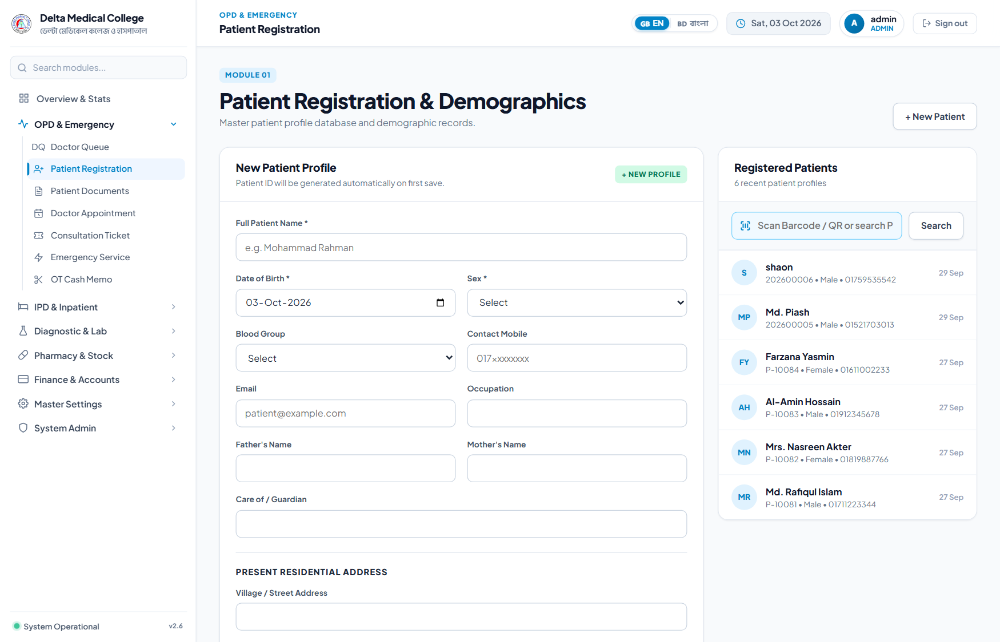

#### কাজের ধারাবাহিক ধাপ:
1. `+ New Registration` বাটনে ক্লিক করুন।
2. রোগীর নাম, মোবাইল নম্বর, বয়স, জেন্ডার এবং রক্তের গ্রুপ ইনপুট দিন।
3. বর্তমান ঠিকানা ও অভিভাবকের মোবাইল নম্বর যুক্ত করুন।
4. `Save Registration` চাপুন। সিস্টেম স্বয়ংক্রিয়ভাবে একটি আজীবন স্থায়ী **Reg No (যেমন: REG-2026-0001)** তৈরি করবে।

---

### ৬.৩ ডক্টর অ্যাপয়েন্টমেন্ট ও সিরিয়াল বুকিং (Doctor Appointments - AP)
* **পাথ:** `/appointments`
* **অনুমোদিত ইউজার:** Reception, Front Desk, Call Center

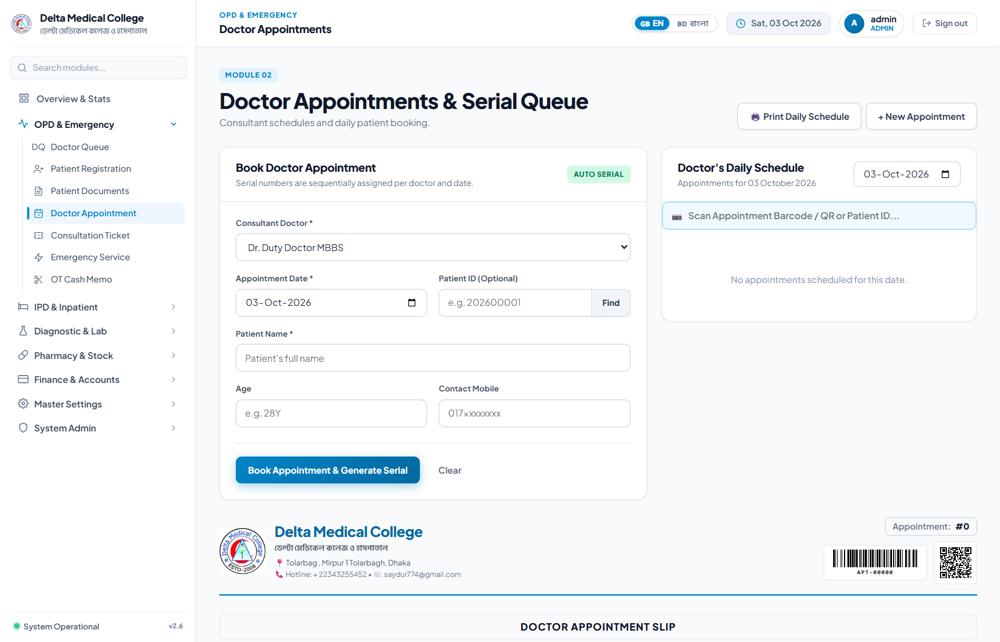

#### কাজের ধারাবাহিক ধাপ:
1. ক্লিনিক্যাল ডিপার্টমেন্ট ও কাঙ্ক্ষিত কনসালট্যান্ট নির্বাচন করুন।
2. অ্যাপয়েন্টমেন্টের তারিখ সিলেক্ট করলে ওই দিনের বর্তমান সিরিয়াল লিস্ট ও অবশিষ্ট স্লট দেখা যাবে।
3. রেজিস্টার্ড রোগীর মোবাইল নম্বর বা নাম দিয়ে সার্চ করে সিরিয়াল কনফার্ম করুন।
4. রোগীকে অ্যাপয়েন্টমেন্ট কনফার্মেশন ও সিরিয়াল নম্বর স্লিপ প্রদান করুন।

---

### ৬.৪ ওপিডি কনসালটেশন টিকিট ও ফি কালেকশন (Consultation Tickets - TK)
* **পাথ:** `/tickets`
* **অনুমোদিত ইউজার:** Cashier, Reception

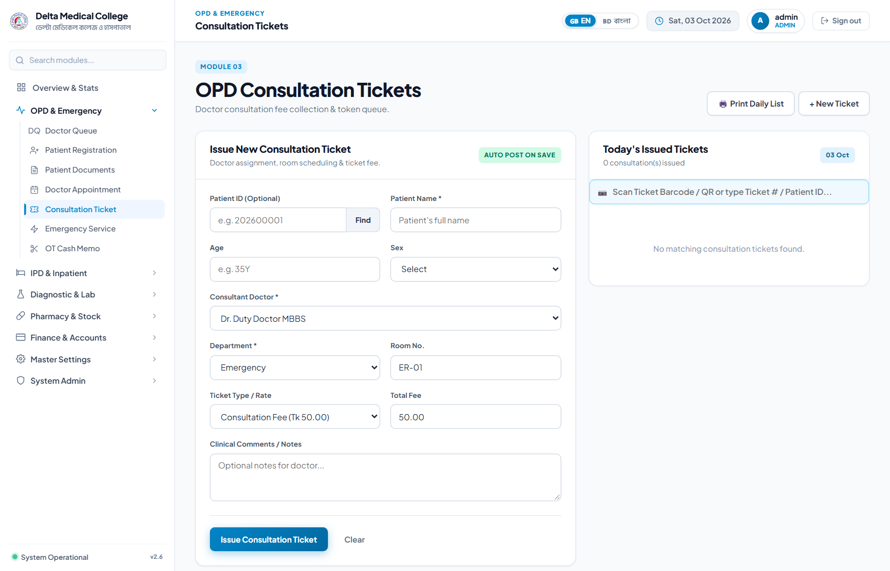

#### কাজের ধারাবাহিক ধাপ:
1. রোগীর রেজিস্ট্রেশন নম্বর সিলেক্ট করুন।
2. ডক্টর এবং টিকিট টাইপ (General / Specialist / Follow-up) সিলেক্ট করুন।
3. সিস্টেমে ডক্টরের নির্ধারিত ফি প্রদর্শিত হলে ক্যাশ গ্রহণ করুন।
4. `Generate & Print Ticket` চাপলে প্রিন্টারে বারকোডযুক্ত টিকিট বের হবে।

---

### ৬.৫ ডক্টর কনসালটেশন কিউ ও ক্লিনিক্যাল ইএমআর (Doctor Queue)
* **পাথ:** `/doctor-queue`
* **অনুমোদিত ইউজার:** Doctor, Medical Officer, Consultant


#### কাজের ধারাবাহিক ধাপ:
1. ডাক্তার তার ব্যক্তিগত অ্যাকাউন্টে লগইন করে আজকের অপেক্ষমাণ সিরিয়াল লিস্ট দেখবেন।
2. রোগীকে চেম্বারে ডাকার জন্য `Call Next Patient` বাটনে ক্লিক করুন।
3. রোগীর পূর্ববর্তী ভিজিট, হিস্ট্রি ও ল্যাব রিপোর্ট পর্যালোচনা করুন।
4. প্রেসক্রিপশন লিখে কনসালটেশন সম্পন্ন (Completed) মার্ক করুন।

---

### ৬.৬ জরুরি বিভাগ ও ইনস্ট্যান্ট প্রসিডিউর বিলিং (Emergency Services - EM)
* **পাথ:** `/emergency-services`
* **অনুমোদিত ইউজার:** Emergency Operator, Cashier

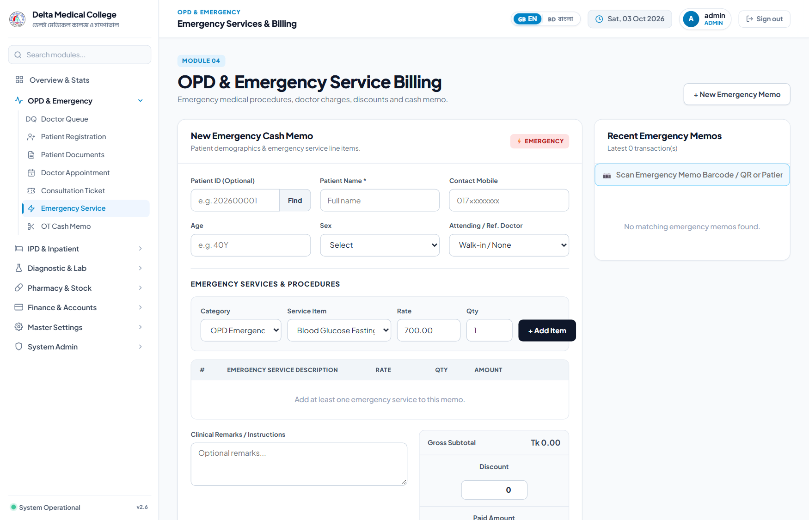

#### কাজের ধারাবাহিক ধাপ:
1. জরুরি রোগীর নাম বা রেজি নং দিয়ে নতুন মেমো খুলুন।
2. প্রদত্ত সেবা ও প্রসিডিউরসমূহ (যেমন: Dressing, Nebulization, Oxygen per hour, Catheterization) যোগ করুন।
3. ব্যবহৃত ইমার্জেন্সি মেডিসিন ও কনজ্যুমাবেল যুক্ত করুন।
4. বিল সম্পন্ন করে পেমেন্ট রিসিভ ও মেমো প্রিন্ট দিন।

---

### ৬.৭ অপারেশন থিয়েটার ও ওটি ক্যাশ মেমো (OT Cash Memo - OT)
* **পাথ:** `/ot-cash-memos`
* **অনুমোদিত ইউজার:** OT Operator, Cashier

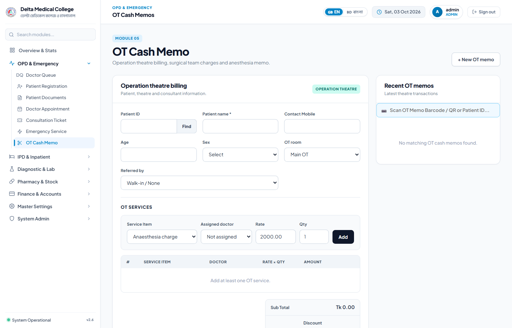

#### কাজের ধারাবাহিক ধাপ:
1. ওটি শিডিউল ও রোগীর ইনফো সিলেক্ট করুন।
2. সার্জারির নাম, প্রধান সার্জন ও অ্যানেস্থেসিওলজিস্ট নির্বাচন করুন।
3. ওটি চার্জ ও ব্যবহৃত বিশেষ সার্জিক্যাল সামগ্রী যুক্ত করুন।
4. মেমো সেভ করে প্রিন্ট দিন; সার্জন ফি স্বয়ংক্রিয়ভাবে সংশ্লিষ্ট একাউন্টস লেজারে ক্রেডিট হবে।

---

### ৬.৮ লাইভ বেড অকুপেন্সি বোর্ড (Bed Occupancy Board - BO)
* **পাথ:** `/ipd/bed-occupancy`
* **অনুমোদিত ইউজার:** IPD Operator, Reception, Nurse, Management

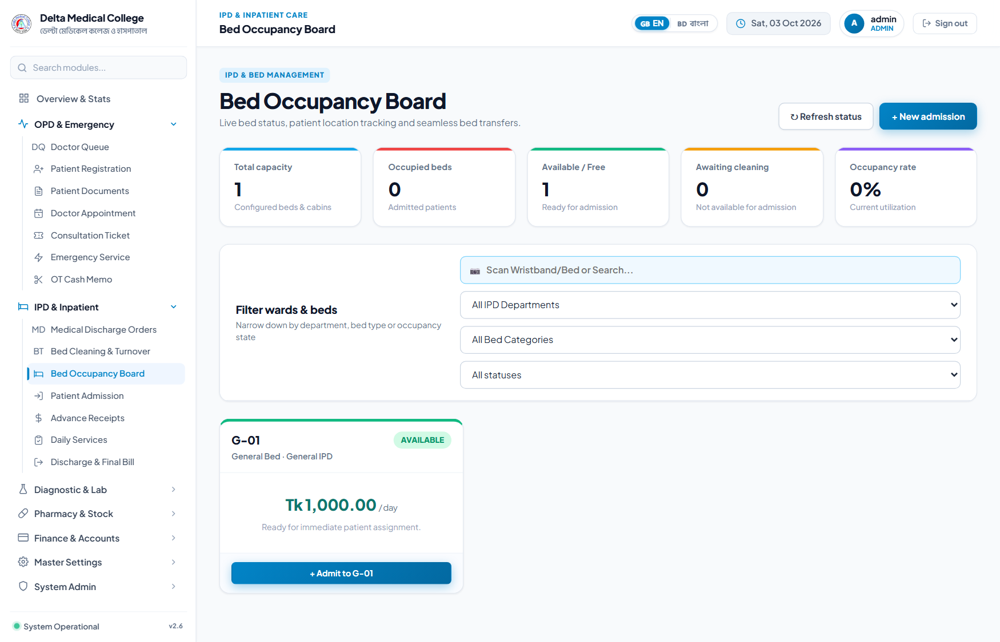

#### কালার-কোডেড বেড স্ট্যাটাস:
* **সবুজ (Green):** খালি বেড (ভর্তির জন্য সম্পূর্ণ প্রস্তুত)।
* **লাল/নীল (Red/Blue):** বুকড বেড (রোগীর নাম, ভর্তির তারিখ ও ডক্টরের নামসহ প্রদর্শিত)।
* **হলুদ (Yellow):** ডিসচার্জ পরবর্তী ক্লিনিং ও স্যানিটাইজেশন চলছে।

---

### ৬.৯ ইনপেশেন্ট রোগী ভর্তি ও বেড বরাদ্দ (IPD Admissions - AD)
* **পাথ:** `/ipd/admissions`
* **অনুমোদিত ইউজার:** IPD Operator, Reception

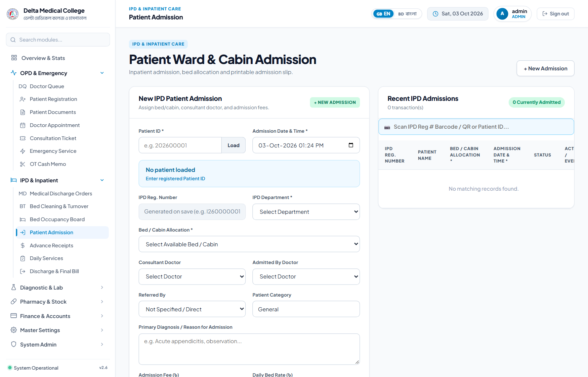

#### কাজের ধারাবাহিক ধাপ:
1. রোগীর রেজি নং দিয়ে সার্চ করুন।
2. অ্যাডমিটিং ডক্টর ও রেফারেল ডক্টর নির্বাচন করুন।
3. কাঙ্ক্ষিত ওয়ার্ড/কেবিন এবং নির্দিষ্ট খালি বেড (Bed No) সিলেক্ট করুন।
4. ডায়াগনোসিস ও অভিভাবকের তথ্য দিয়ে `Admit Patient` কনফার্ম করুন। স্বয়ংক্রিয়ভাবে **IPD No** তৈরি হবে।

---

### ৬.১০ আইপিডি অগ্রিম জমা ও মানি রিসিট (Advance Receipts - AR)
* **পাথ:** `/ipd/advance-receipts`
* **অনুমোদিত ইউজার:** Cashier, IPD Accounts

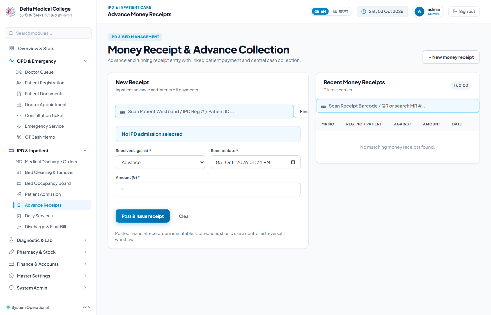

#### কাজের ধারাবাহিক ধাপ:
1. রোগীর IPD No দিয়ে সার্চ করুন।
2. জমার পরিমাণ ও পেমেন্ট মাধ্যম সিলেক্ট করুন।
3. ক্যাশ রিসিভ করে `Save & Print Receipt` চাপুন।
4. রোগীর মোট জমা ও বকেয়া স্ট্যাটাস রিয়েল-টাইমে আপডেট হবে।

---

### ৬.১১ আইপিডি দৈনিক সার্ভিস ও নার্সিং চার্জ (Daily Patient Services - DS)
* **পাথ:** `/ipd/patient-services`
* **অনুমোদিত ইউজার:** Nurse, IPD Billing Operator

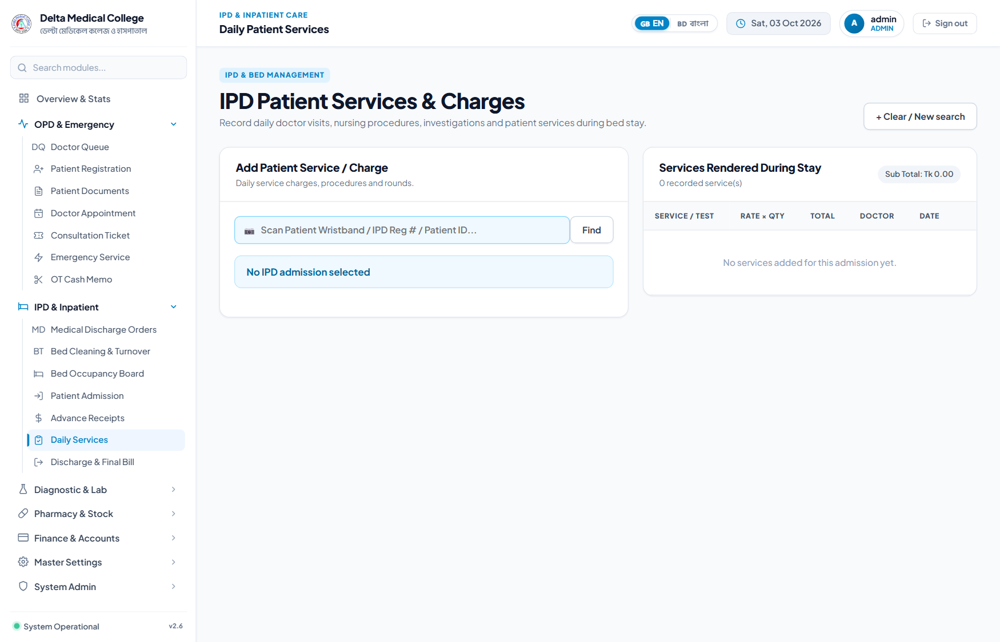

#### কাজের ধারাবাহিক ধাপ:
1. রোগীর আইপিডি ফাইল সিলেক্ট করুন।
2. প্রদত্ত সার্ভিস (ডক্টর রাউন্ড, বিশেষ নার্সিং, ফিজিওথেরাপি) যোগ করুন।
3. কোয়ান্টিটি ও রেট কনফার্ম করে রোগীর রানিং বিলে পোস্ট করুন।

---

### ৬.১২ মেডিকেল ডিসচার্জ ক্লিয়ারেন্স অর্ডার (Medical Discharge Orders)
* **পাথ:** `/ipd/medical-discharge-orders`
* **অনুমোদিত ইউজার:** Doctor, Consultant, Medical Officer

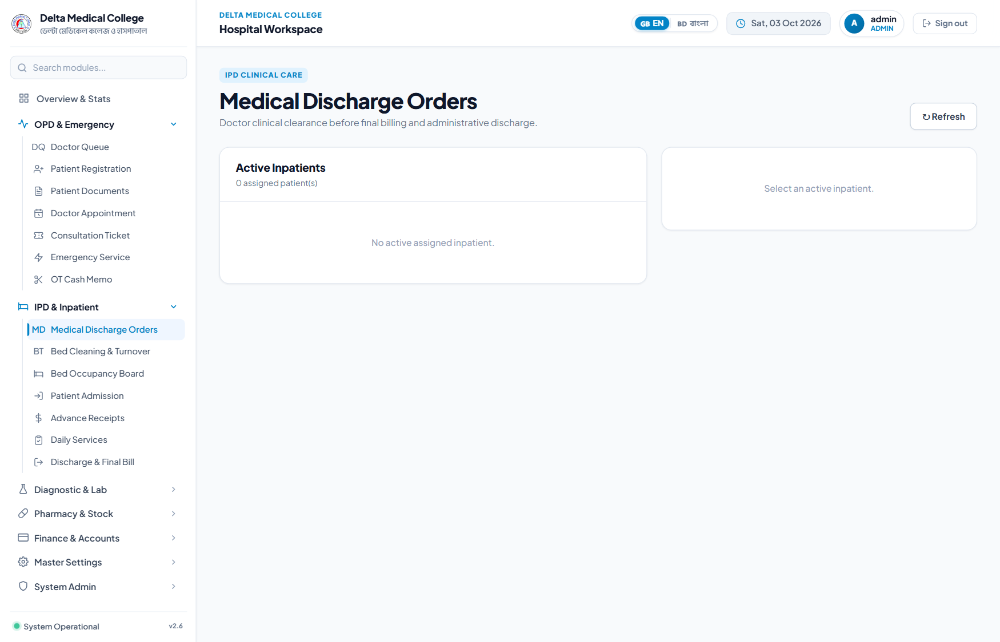

#### কাজের ধারাবাহিক ধাপ:
1. চিকিৎসক সুস্থ হওয়া রোগীকে নির্বাচন করবেন।
2. ডিসচার্জ সামারি, চিকিৎসার বিবরণ ও পরবর্তী ফলো-আপ ওষুধ লিখবেন।
3. `Approve Medical Discharge` চাপলে বিলিং কাউন্টারে ক্লিয়ারেন্স যাবে।

---

### ৬.১৩ বেড টার্নওভার ও হাউসকিপিং স্যানিটাইজেশন (Bed Turnover)
* **পাথ:** `/ipd/bed-turnover`
* **অনুমোদিত ইউজার:** Housekeeping Supervisor, Ward In-charge

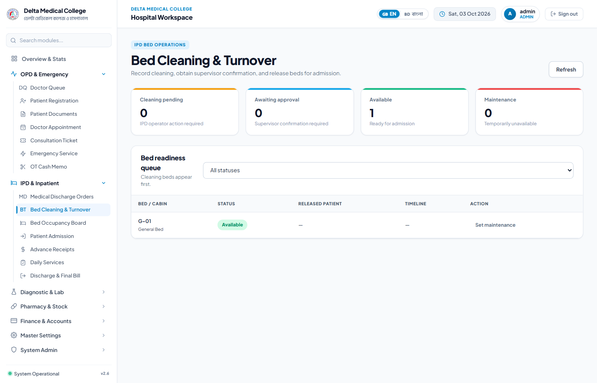

#### কাজের ধারাবাহিক ধাপ:
1. রোগী চলে যাওয়ার পর বেডটি ক্লিনিং তালিকায় আসে।
2. হাউসকিপিং স্টাফ বেড পরিষ্কার ও লিনেন পরিবর্তন সম্পন্ন করবেন।
3. `Mark as Ready & Sanitized` চাপলে বেড অকুপেন্সি বোর্ডে বেডটি গ্রিন হয়ে যাবে।

---

### ৬.১৪ আইপিডি ফাইনাল ডিসচার্জ ও বিল সেটেলমেন্ট (IPD Final Discharge - DC)
* **পাথ:** `/ipd/discharge-billing`
* **অনুমোদিত ইউজার:** Cashier, Accounts In-charge

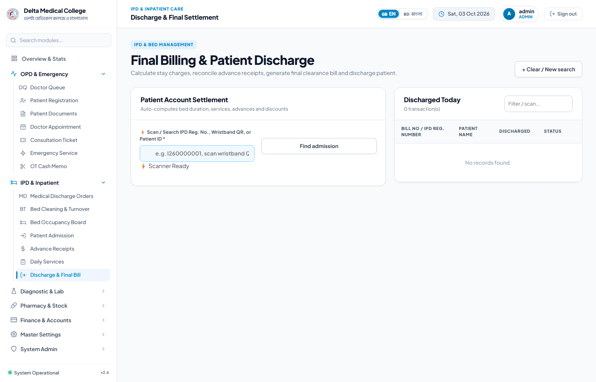

#### কাজের ধারাবাহিক ধাপ:
1. রোগীর IPD No সিলেক্ট করুন।
2. সিস্টেম স্বয়ংক্রিয়ভাবে বেড রেন্ট, ডক্টর ফি, সার্ভিস, ফার্মেসি ও পূর্বের এডভান্স সমন্বয় করে নেট বিল দেখাবে।
3. কোনো ছাড় (Discount) প্রযোজ্য হলে অনুমোদনের নোটে ইনপুট দিন।
4. বকেয়া টাকা আদায় করে `Complete Settlement & Print Final Bill` চাপুন। বেডটি স্বয়ংক্রিয়ভাবে খালি হয়ে যাবে।

---

### ৬.১৫ ডায়াগনস্টিক টেস্ট বুকিং ও বিলিং (Diagnostic Billing - DX)
* **পাথ:** `/diagnostic/billing`
* **অনুমোদিত ইউজার:** Cashier, Diagnostic Reception

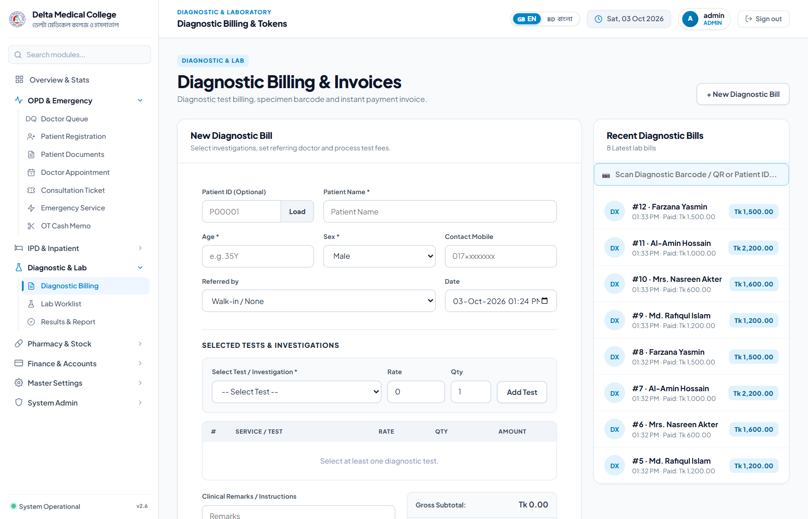

#### কাজের ধারাবাহিক ধাপ:
1. রোগীর তথ্য ও রেফারেল ডক্টর নির্বাচন করুন।
2. প্রেসক্রাইবড ল্যাব টেস্টসমূহ সিলেক্ট করুন।
3. ক্যাশ গ্রহণ করে ইনভয়েস ও বারকোড স্লিপ রোগীকে দিন।

---

### ৬.১৬ ল্যাব স্যাম্পল কালেকশন ওয়ার্কলিস্ট (Diagnostic Worklist - LW)
* **পাথ:** `/diagnostic/worklist`
* **অনুমোদিত ইউজার:** Lab Technician, Phlebotomist

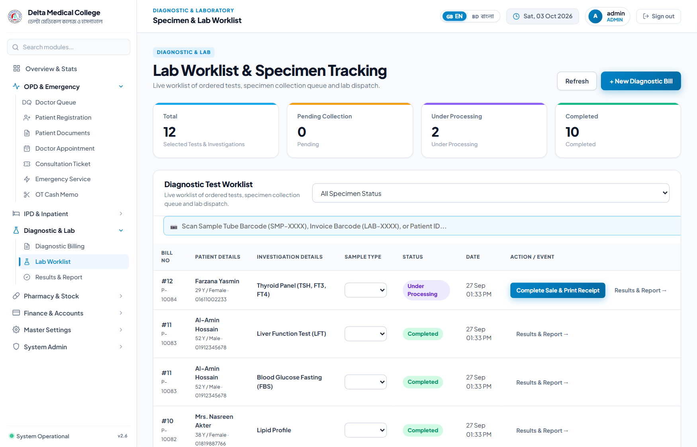

#### কাজের ধারাবাহিক ধাপ:
1. রোগীর বারকোড স্ক্যান করুন।
2. রক্তের নমুনা গ্রহণ করে `Sample Collected` স্ট্যাটাস দিন।
3. অ্যানালাইজারে টেস্ট রান করার সময় স্ট্যাটাস `In-Process` মার্ক করুন।

---

### ৬.১৭ ল্যাব রেজাল্ট এন্ট্রি ও নরমাল রেঞ্জ ভেরিফিকেশন (Lab Results - LR)
* **পাথ:** `/diagnostic/results`
* **অনুমোদিত ইউজার:** Lab Technician, Pathologist, Doctor

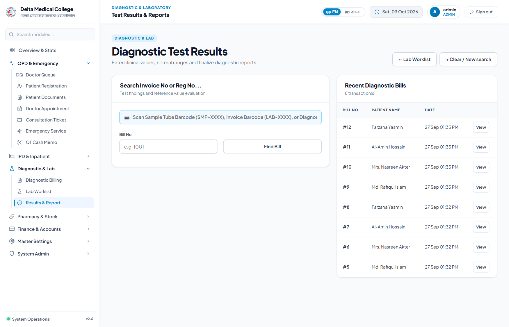

#### কাজের ধারাবাহিক ধাপ:
1. টেস্ট সিলেক্ট করে প্রতিটি প্যারামিটারের প্রাপ্ত মান ইনপুট দিন।
2. সিস্টেম নরমাল রেঞ্জের বাইরে থাকা মানকে High/Low এলার্ট দেবে।
3. প্যাথলজিস্ট ভেরিফাই করার পর কিউআর কোডযুক্ত ভেরিফায়েড রিপোর্ট প্রিন্ট করুন।

---

### ৬.১৮ ফার্মেসি কাউন্টার পিওএস সেলস (Pharmacy POS - POS)
* **পাথ:** `/pharmacy/pos`
* **অনুমোদিত ইউজার:** Pharmacy Operator, Pharmacist

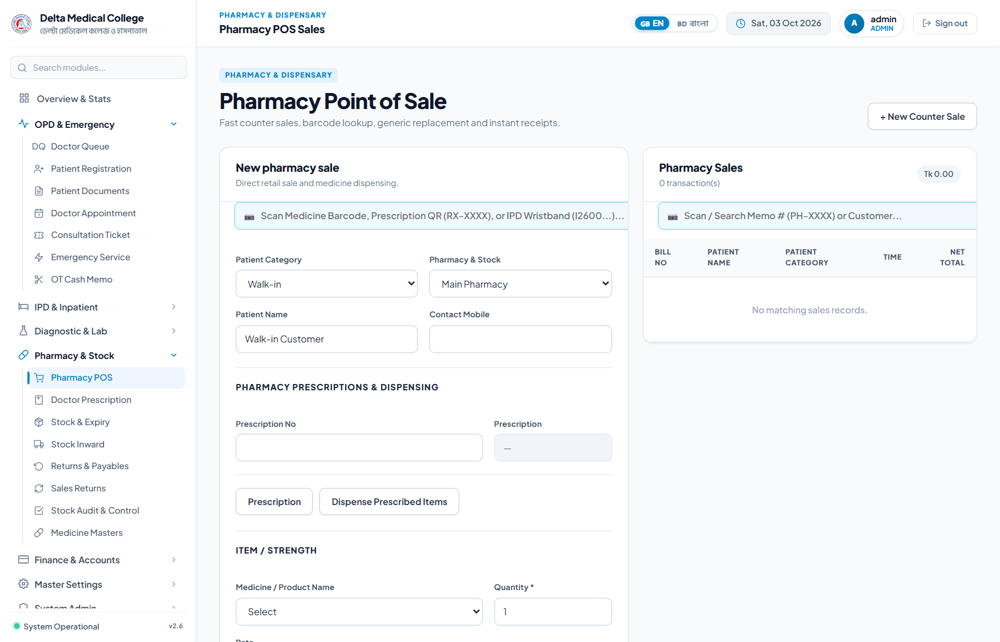

#### কাজের ধারাবাহিক ধাপ:
1. বারকোড স্ক্যান করুন অথবা ওষুধের নাম/জেনেরিক দিয়ে সার্চ করুন।
2. সিস্টেম প্রথম মেয়াদোত্তীর্ণ হতে যাওয়া ব্যাচ (FIFO) স্বয়ংক্রিয় সিলেক্ট করবে।
3. ক্যাশ রিসিভ করে মানি মেমো প্রিন্ট দিন; স্টকের পরিমাণ সাথে সাথে বিয়োগ হবে।

---

### ৬.১৯ স্টক ইনওয়ার্ড ও পারচেজ চালান (Stock Inward - PI)
* **পাথ:** `/pharmacy/purchases`
* **অনুমোদিত ইউজার:** Pharmacy In-charge, Store Keeper

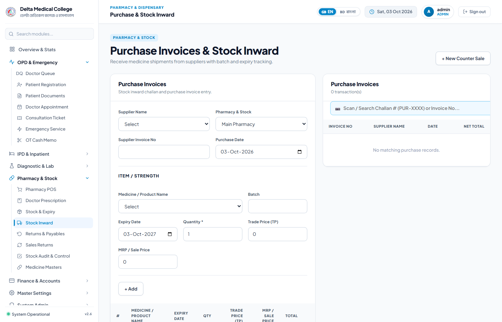

#### কাজের ধারাবাহিক ধাপ:
1. সাপ্লায়ার কোম্পানি ও চালান নম্বর ইনপুট দিন।
2. ওষুধের নাম, ব্যাচ নম্বর ও এক্সপায়ারি ডেট দিন।
3. ক্রয়মূল্য ও বিক্রয়মূল্য দিয়ে চালান কনফার্ম করে স্টকে যোগ করুন।

---

### ৬.২০ লাইভ মেডিসিন স্টক ও এক্সপায়ারি মনিটরিং (Pharmacy Stock - ST)
* **পাথ:** `/pharmacy/stock`
* **অনুমোদিত ইউজার:** Pharmacist, Store In-charge

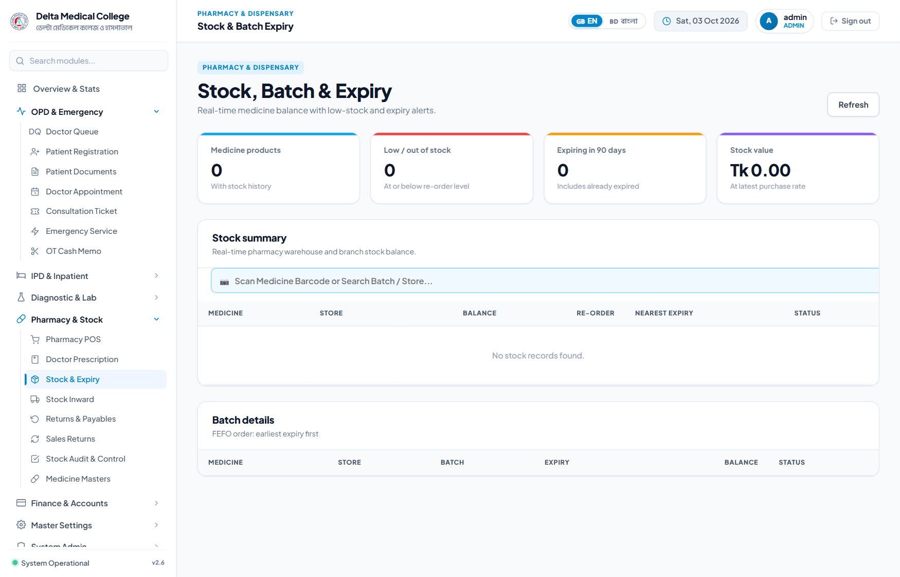

#### মূল ফিচার:
* বর্তমান মজুদ, রি-অর্ডার লেভেলের নিচে থাকা ওষুধ এবং আগামী ৩০/৬০/৯০ দিনের মধ্যে মেয়াদ শেষ হতে যাওয়া ব্যাচের ফিল্টারিং।

---

### ৬.২১ স্টক ভ্যারিয়েন্স ও ফিজিক্যাল অডিট (Stock Control - SC)
* **পাথ:** `/pharmacy/stock-control`
* **অনুমোদিত ইউজার:** Store Auditor, Pharmacy Manager

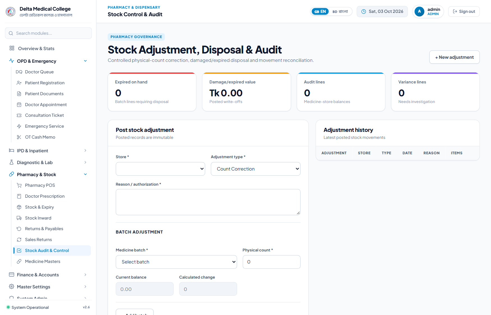

#### কাজের ধারাবাহিক ধাপ:
1. ড্রাগ বা রেক সিলেক্ট করে ফিজিক্যাল কোয়ান্টিটি ইনপুট দিন।
2. সিস্টেমের সাথে ভ্যারিয়েন্স মিলিয়ে অ্যাডজাস্টমেন্ট পোস্ট করুন।

---

### ৬.২২ ফিন্যান্স, অ্যাকাউন্টস ও শিফট ক্লোজিং (Accounts & General Ledger)
* **পাথ:** `/accounts`
* **অনুমোদিত ইউজার:** Accountant, Finance Manager, Cashier

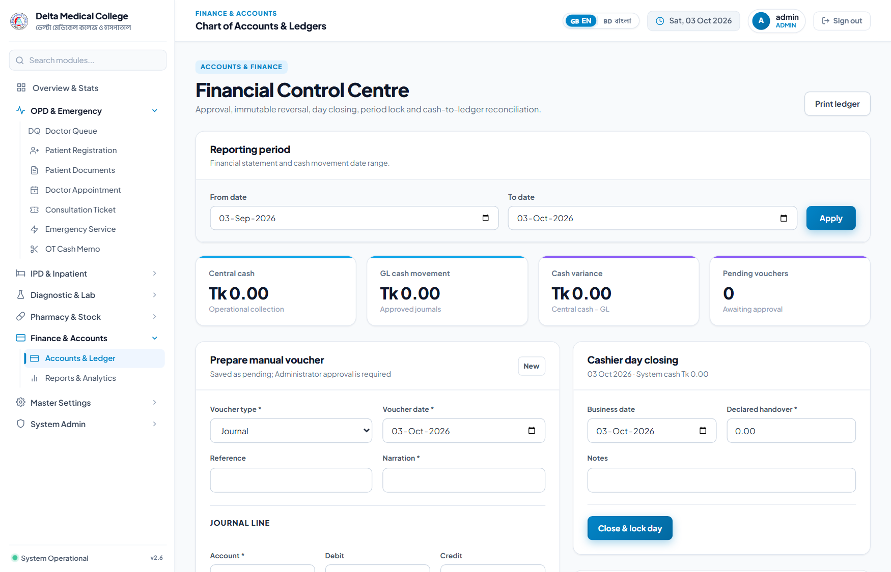

#### মূল ফিচার:
1. প্রতিটি বিলের জন্য রিয়েল-টাইম সাব-লেজার ডেবিট-ক্রেডিট পোস্টিং।
2. হাসপাতালের বিবিধ খরচের জন্য Debit/Credit Voucher এন্ট্রি।
3. শিফট শেষে ক্যাশ কাউন্টারের টাকা মিলিয়ে `Shift Handover` সম্পন্ন করা।

---

### ৬.২৩ অ্যাডভান্সড রিপোর্ট ও অ্যানালিটিক্স (Hospital Reports & Analytics)
* **পাথ:** `/reports`
* **অনুমোদিত ইউজার:** Administrator, Management, Auditor

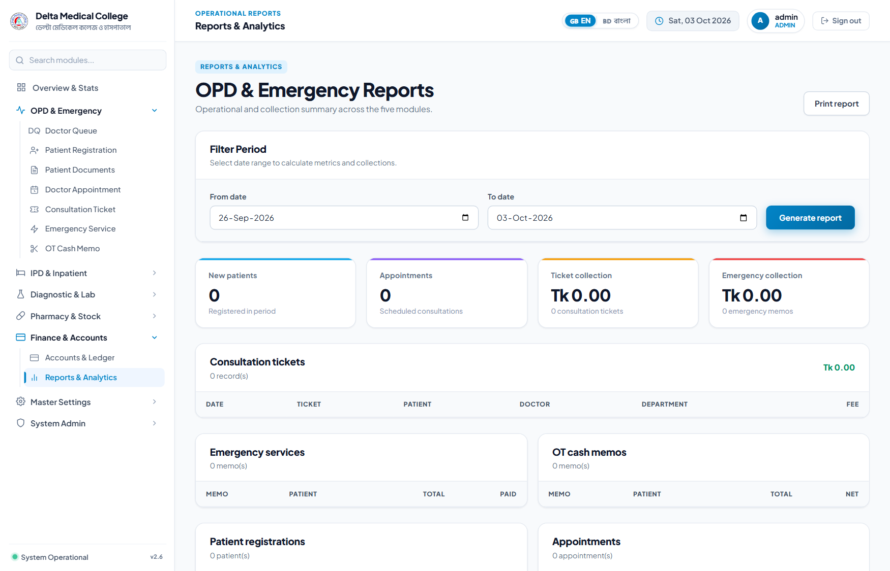

#### প্রধান রিপোর্টসমূহ:
* **Daily Cash Summary:** কোন কাউন্টারে কত টাকা জমা হয়েছে।
* **Department Revenue Breakdown:** ওপিডি, আইপিডি, প্যাথলজি ও ফার্মেসির আয়ের অনুপাত।
* **Doctor Consultation & Referral Summary:** ডক্টরদের ভিজিট ও রেফারেল হিসেব।
* **Due Collection Statement:** বকেয়া আদায়ের স্টেটমেন্ট।

---

### ৬.২৪ মাস্টার কনফিগারেশন (Clinical, Bed, Lab & Drug Masters)
* **পাথ:** `/masters`, `/masters/ipd`, `/diagnostic/masters`, `/pharmacy/masters`
* **অনুমোদিত ইউজার:** System Administrator

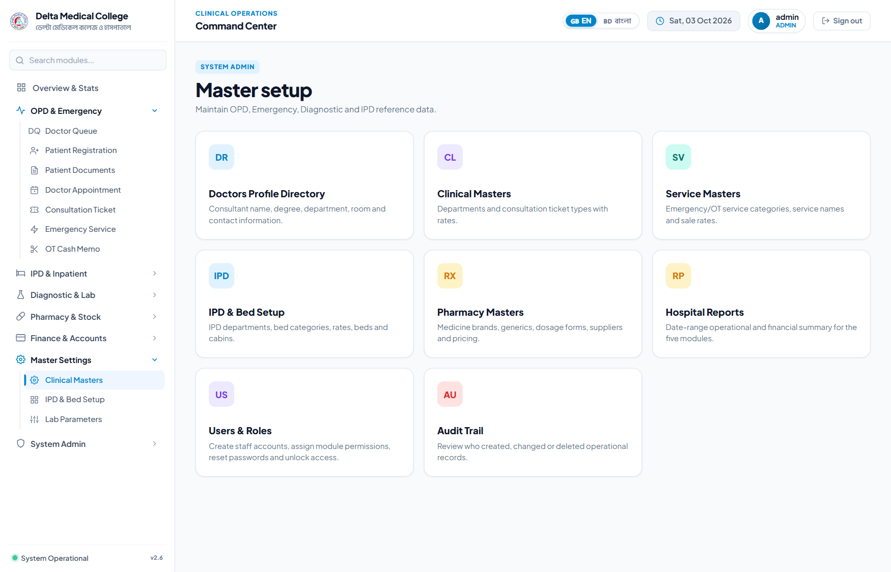

#### কনফিগারেশনের ধাপ:
* ডক্টর তালিকা, স্পেশালাইজেশন, ওপিডি ডিপার্টমেন্ট, ওয়ার্ড, কেবিন, বেড রেন্ট, ল্যাব প্যারামিটার এবং মেডিসিন ব্র্যান্ড সেটআপ।

---

### ৬.২৫ ইউজার অ্যাডমিন ও রোল পারমিশন (User Admin & Roles)
* **পাথ:** `/admin/users`
* **অনুমোদিত ইউজার:** System Administrator

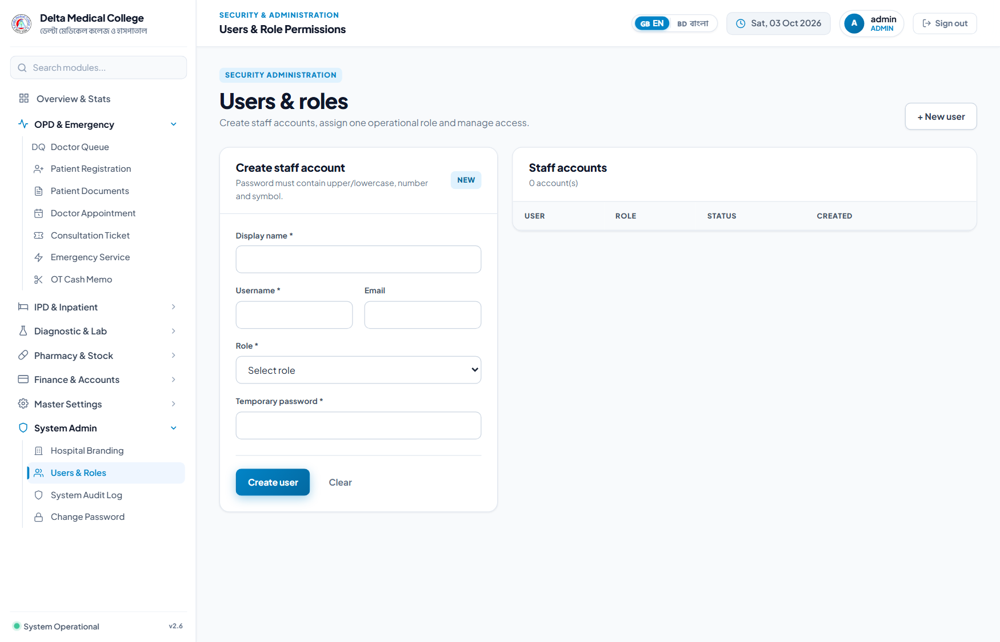

#### কাজের ধারাবাহিক ধাপ:
1. `+ Create New User` চেপে স্টাফের ইউজারনেম ও তথ্য দিন।
2. ১০টি সুনির্দিষ্ট রোলের মধ্য থেকে প্রযোজ্য রোল সিলেক্ট করুন।
3. স্টাফের একাউন্ট সক্রিয় বা পাসওয়ার্ড রিসেট পরিচালনা করুন।

---

### ৬.২৬ রিয়েল-টাইম সিস্টেম অডিট লগ (Audit Trail & Forensic Logs)
* **পাথ:** `/admin/audit`
* **অনুমোদিত ইউজার:** Administrator, Auditor

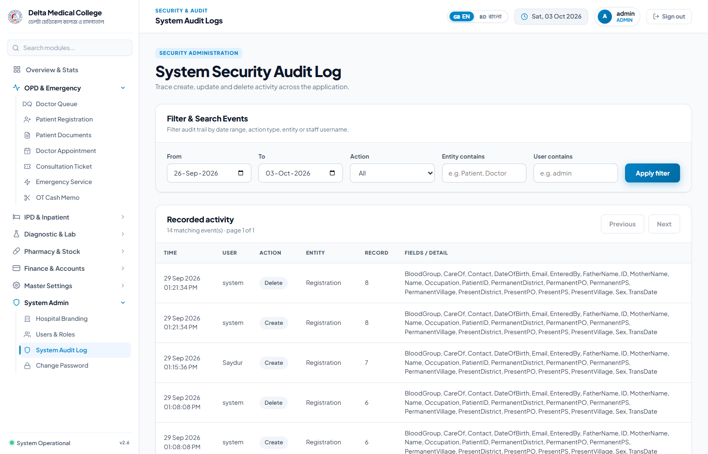

#### নিরাপত্তা ট্র্যাকিং:
* কে, কখন, কোন আইপি থেকে কোন ইনভয়েস তৈরি বা এডিট করেছেন তার বিস্তারিত অতীত ও বর্তমান মানের রেকর্ড।

---

### ৬.২৭ হসপিটাল প্রোফাইল ও প্রিন্ট হেডার সেটিংস (Hospital Profile)
* **পাথ:** `/hospital-settings`
* **অনুমোদিত ইউজার:** Administrator


#### সেটিংস ধাপ:
* হাসপাতালের অফিসিয়াল নাম, লোগো, ঠিকানা, হটলাইন নম্বর ও মানি রিসিটের ফুটার পলিসি নোট কাস্টমাইজেশন।

---

## ৭. সমস্যা ও সমাধান (Troubleshooting & FAQs)

### ১. ডাটাবেজ কানেকশন এরর দেখালে কি করব?
* **সমাধান:** উইন্ডোজ সার্ভিসে `SQL Server (HPMDB)` সার্ভিস চালু আছে কি না পরীক্ষা করুন।

### ২. লগইন করার সাথে সাথে পাসওয়ার্ড চেঞ্জ পেজে নিয়ে যায় কেন?
* **সমাধান:** প্রথমবার তৈরি হওয়া একাউন্টের নিরাপত্তার স্বার্থে `MustChangePassword` সক্রিয় থাকে। নতুন পাসওয়ার্ড সেট করলেই ড্যাশবোর্ডে প্রবেশ করা যাবে।

### ৩. ফার্মেসিতে ওষুধ বিক্রয়ের সময় স্টক শূন্য দেখাচ্ছে কেন?
* **সমাধান:** ওষুধটি বিক্রয় করার আগে **Stock Inward (`/pharmacy/purchases`)** মডিউল থেকে চালানের মাধ্যমে নির্দিষ্ট ব্যাচ ও এক্সপায়ারি দিয়ে স্টকে যোগ করে নিতে হবে।

### ৪. আইপিডি ফাইনাল বিলে পূর্বের জমা করা এডভান্স স্বয়ংক্রিয় বাদ যাবে কি?
* **হ্যাঁ:** সিস্টেম রোগীর সবকটি এডভান্স মানি রিসিটের মোট পরিমাণ স্বয়ংক্রিয় হিসাব করে গ্র্যান্ড টোটাল থেকে মাইনাস করে নেট প্রদেয় টাকা প্রদর্শন করবে।

---

> **কারিগরি সহায়তার জন্য:** সিস্টেম সংক্রান্ত যেকোনো জিজ্ঞাসা বা কাস্টমাইজেশনের জন্য সফটওয়্যার অ্যাডমিনিস্ট্রেটর বা আইসিটি টিমের সাথে যোগাযোগ করুন।
